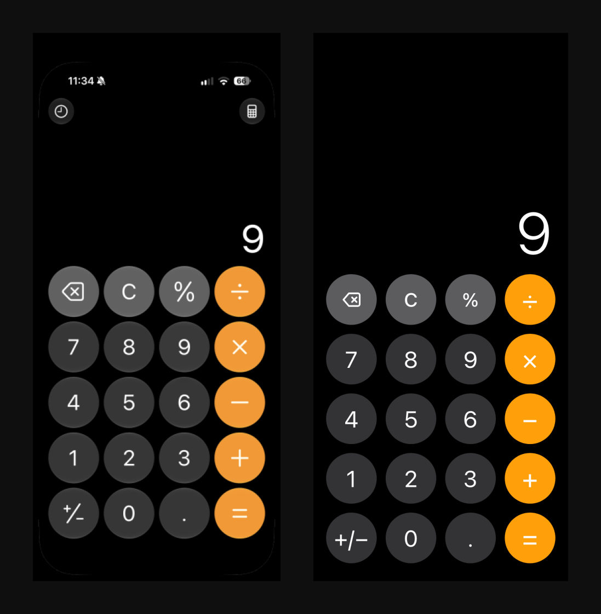
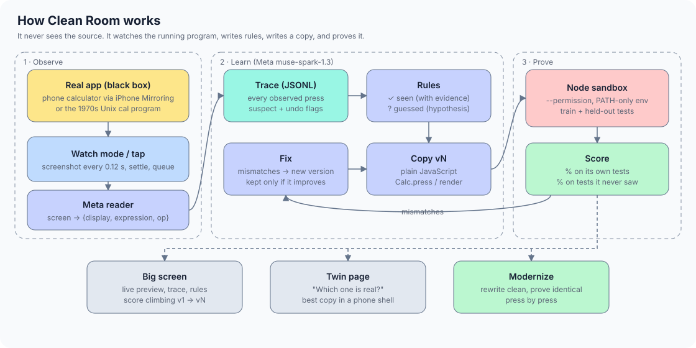
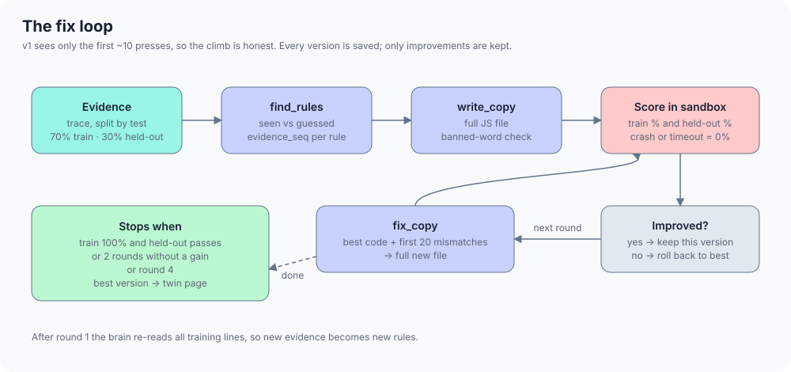
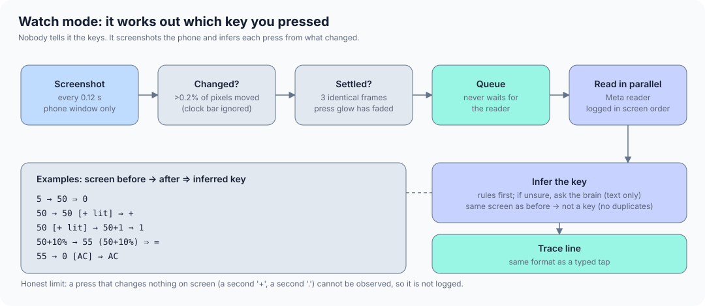
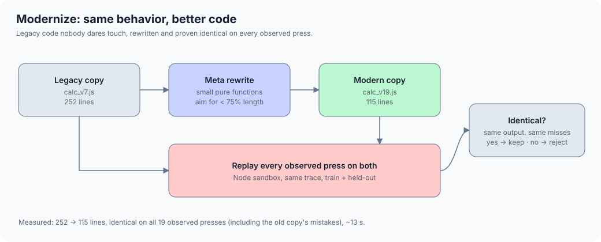
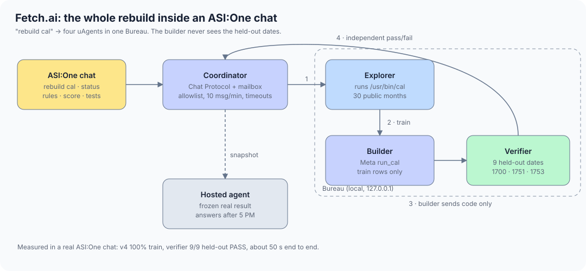

# Clean Room

**An AI that rebuilds software just by watching it.**

It watches a program run, writes down every rule it sees, writes a working copy, and proves the copy behaves the same on tests it never saw. Then it can rewrite that copy as clean, modern code and prove nothing changed.


Built in one day at the AIE Code Summit hackathon (Nov 7, 2026) by a team of two.

<p align="center">
  
  <br><em>Which one is real? Left: the phone's calculator. Right: a copy written by an AI that never saw its code.</em>
</p>

---

## Why

Software outlives the people who wrote it. When Insteon shut down in 2022, people's smart homes stopped working overnight. Companies run systems nobody dares touch because the original authors are gone and the source is lost, unreadable, or locked behind a dead vendor.

The behavior is still there, though. You can still watch the program run.

Clean Room turns that behavior into three things a company can use:

| You get | What it is |
|---|---|
| **A manual** | Every rule the program follows, each tagged **seen** (with the exact presses that prove it) or **guessed** (a hypothesis to test) |
| **A replacement** | A working copy in plain JavaScript |
| **Proof** | Scores on tests the copy never trained on, and a press-by-press equivalence check when it gets modernized |

---

## How it works



1. **Observe.** The phone's screen is mirrored to the Mac. In watch mode the server screenshots it several times a second and works out which key was pressed from what changed. Nobody types the keys in.
2. **Read.** Meta `muse-spark-1.3` reads each settled screen into `{display, expression, clear_label, active_op}`. A plain-code sanity check flags misreads (after `7` the display must end in `7`; after `AC` it must show `0`).
3. **Learn.** Meta reads the trace and writes rules, each tagged seen or guessed. Then it writes a full copy.
4. **Prove.** The copy runs in a locked-down Node sandbox against the trace, split 70/30 into tests it trains on and tests it never sees.
5. **Fix.** Mismatches go back to Meta, which writes the next version. A version is kept only if it scores higher; otherwise it rolls back.

### The fix loop



Version 1 is built from only the first ~10 presses. Evidence grows as people keep pressing keys, so the score climb is honest: the copy gets better because it has seen more, not because it was handed the answers.

### Watch mode



The screenshot loop never waits for the model. Every settled screen goes into a queue, the reader works through them in parallel, and lines are logged in screen order. In a fast-typing test (`AC 5 0 + 1 0 =`, one key every 0.7 s, with press glows) it logged all 6 keys correctly, with no duplicates, 1.4 s after the last press.

### Modernize



The part companies actually pay for: take code nobody dares touch, rewrite it clean, and **prove** it still does exactly the same thing. The rewrite is kept only if it gives the same output as the old code on every observed press, mistakes included. If anything changes, it's rejected.

---

## Results (measured today)

| What | Result |
|---|---|
| Phone calculator, score climb | v1 66.7% → v2 73.3% → **v4 93.3%** on its own tests, **75%** on tests it never saw (early trace, 19 usable presses) |
| Rule it found | `50 + 10 % = 55` (percent of the first number), marked **seen** |
| `cal` (the Unix calendar program) | **100%** on training dates, **100%** on held-out dates (Sept 1751, Sept 1753, Feb 1700, Mar 2025) |
| `cal` rule it found | September 1752 jumps from the 2nd to the 14th, marked **seen** |
| Fetch.ai, real ASI:One chat | `rebuild cal` → v4 100% train, independent verifier **9/9 held-out PASS**, about 50 s end to end |
| Modernize | **252 → 115 lines**, identical on all 19 observed presses, about 13 s |
| Screen read (Meta, minimal reasoning) | 2.1–2.9 s per read |
| Copy written (Meta, minimal reasoning) | about 13 s per version (4.5 minutes at default reasoning, which is why we turned it down) |
| Watch mode, simulated fast typing | 6/6 keys, 0 duplicates |
| Test suite | 62 passing (`uv run --with pytest python -m pytest -q`), plus 6 agent runtime tests |

---

## Fetch.ai: the whole rebuild in an ASI:One chat



Type `rebuild cal` in ASI:One and four uAgents do the work in one Bureau:

| Agent | Name | Address | Job |
|---|---|---|---|
| Coordinator | `cleanroom-coordinator-ee13ec` | `agent1qvknkpk00qmxeuxzkfv2w6xwe4pdmm60l25wju8rvekzxeacwv7vkzj6cmv` | The only agent you talk to. Chat Protocol, Agentverse mailbox, allowlist, rate limit |
| Explorer | `cleanroom-explorer-ee13ec` | `agent1qds302wfpy5zs5erqycl3009rlgyscs8hxeveekmkehfp4p98djz2d2dgud` | Runs `/usr/bin/cal` for 30 public months |
| Builder | `cleanroom-builder-ee13ec` | `agent1qtnplcu8dp8atg38net0xdgctlaq0l097604eahunjy00ch40y2hw5s4x30` | Calls the Meta brain on **training rows only** |
| Verifier | `cleanroom-verifier-ee13ec` | `agent1qd53r9v2r58xcy9e3mzxd7n49226jm03zcyr847m9w340g2m59zdws4tkcw` | Scores the code on 9 held-out dates it measures itself |

A hosted agent answers `status`, `rules`, `score` and `tests` from a frozen copy of a real run, so it still works when the laptop is off.

**Try it in ASI:One** (search for `cleanroom-coordinator-ee13ec`, or mention its address):

```text
rebuild cal
status
rules
score
tests
rebuild excel      → "Unknown target."
```

Details: [agent/README.md](agent/README.md) · [agent/ADDRESSES.md](agent/ADDRESSES.md) · [agent/VERIFICATION.md](agent/VERIFICATION.md)

---

## Meta's role

Meta `muse-spark-1.3` is both the eyes and the brain:

- **Eyes:** reads the phone screen after every press.
- **Brain:** writes the rules (seen vs guessed), writes each copy, fixes it from mismatches, picks the next test to try, rebuilds `cal` for the agents, and modernizes the final copy.

We run it with `reasoning_effort="minimal"`. At the default setting it thought for about 4.5 minutes before writing a copy; at minimal it takes about 13 seconds and the copies still score the same. Gemini Flash-Lite is wired in as a fallback only.

---

## Security

AI-written code never runs unchecked.

- Copies run in Node with `--permission`: they can read only the checker and their own files, write nothing, and get **no environment variables except `PATH`**, so API keys are invisible to them.
- Inside Node, each copy runs in a fresh `vm` context with string code generation turned off and a 1-second timeout. A crash or timeout scores 0%.
- We attacked it ourselves: a hostile copy that escapes the `vm` and goes looking for keys finds none, and its attempt to read `.env` is denied (`ERR_ACCESS_DENIED`). The same test runs against the agents' `cal` checker, which also can't read the agent's private identity file.
- Model output is never passed to `eval`, `exec` or a shell. `cal` only ever receives two integers.
- The server binds `127.0.0.1` only. API keys live in `.env`, which has been git-ignored since the first commit; they have never been in this repo's history.

---

## Run it

Requirements: macOS, Python 3.12 with [uv](https://docs.astral.sh/uv/), Node 24+ (for the `--permission` sandbox), and an iPhone with iPhone Mirroring (or any webcam).

```bash
git clone https://github.com/Shri2007/cleanroom.git && cd cleanroom
cp .env.example .env          # add MODEL_API_KEY (Meta) and GEMINI_API_KEY (fallback)
uv sync
CLEANROOM_SOURCE=screen uv run uvicorn server.app:app --host 127.0.0.1 --port 8000
```

| Page | URL |
|---|---|
| Big screen | http://127.0.0.1:8000/screen |
| Twin ("which one is real?") | http://127.0.0.1:8000/twin |
| Operator keypad | http://127.0.0.1:8000/ |
| Phone copy (GitHub Pages) | `docs/play.html`, installable on a phone |

Big-screen keys: **W** watch the phone · **R** run the brain · **T** ask for a test · **M** modernize · **N** new session.

Other frame sources: `CLEANROOM_SOURCE=camera` (webcam, index via `CLEANROOM_CAMERA`) or `CLEANROOM_FRAME=photo.jpg` (a still image, for testing).

Run the brain on a saved trace from the terminal:

```bash
uv run python -m server.brain traces/<session>.jsonl
```

Fetch.ai agents: `uv run python -m agent.coordinator`. Tests: `uv run --with pytest python -m pytest -q`.

---

## Developer guide

Deterministic checks that need no camera and no API keys.

### Run the checker

The checker loads a copy (the generated calculator implementation) into a Node VM and compares its display state against a recorded trace. Use the Python wrapper so the copy also runs under Node's permission sandbox:

```bash
node --version   # must be v24+

uv run python -m server.checker tests/fixtures/calc_good.js traces/sample.jsonl
```

Expected result:

```text
match 100%  (5/5 lines)
```

To prove the checker is not a rubber stamp, score the deliberately wrong copy:

```bash
uv run python -m server.checker tests/fixtures/calc_bad.js traces/sample.jsonl
## match 80%  (4/5 lines)
```

The raw Node entry point is available for debugging:

```bash
node checker/check.mjs tests/fixtures/calc_good.js traces/sample.jsonl
```

#### Checker tests

```bash
uv run python -m unittest tests.test_checker tests.test_checker_cal tests.test_checker_secrets -v
```

This runs 15 tests, including the sandbox escape/secret-leak checks.

### Camera and operator smoke test

The deterministic smoke test needs **no camera and no API keys**. It drives the real FastAPI app through its ASGI interface with a fake capture device and a deterministic reader, exercises taps, Snap, and Undo, then scores the resulting trace with the real checker:

```bash
uv run python -m unittest tests.test_camera_operator -v
```

This runs 5 tests. It is the reproducible camera/operator proof until the real iPhone camera and vision keys are available.

For a live hardware run:

1. Start the server with the camera index you want (see above).
2. Open the operator page, confirm the live preview, enter a known calculation, press **Snap**, and press **Undo**.
3. Score the session trace:

```bash
uv run python -m server.checker tests/fixtures/calc_good.js traces/<timestamp>.jsonl
```

The live reader is the vision model. Its readings will only match the reference copy when the camera sees the expected calculator state; use the deterministic test above when you need a repeatable 100% result.

### CI

The [`Checker and camera`](.github/workflows/checker.yml) workflow runs on pushes to `main` and `freebuff/**` and on pull requests to `main`:

- **Node 24 checker tests** on `ubuntu-latest`: `tests.test_checker`, `tests.test_checker_cal`, and `tests.test_checker_secrets` (15 tests).
- **Node 24 camera + operator test** on `macos-latest`: `uv sync --frozen` followed by `tests.test_camera_operator` (5 tests). macOS is required because the app imports Quartz and uses OpenCV.

Both jobs pin Node 24 before running the tests. The Ubuntu job invokes the checker tests without `uv sync` because the checker is stdlib-only and the full app dependencies include macOS-only PyObjC. The camera job does not use a physical camera or API keys.

---

## Repo layout

```text
server/    app.py (routes, capture, live events) · reader.py (screen → JSON) · trace.py
           brain.py (rules, copies, fix loop, cal, modernize) · watch.py (key inference)
           camera.py · checker.py
checker/   check.mjs (sandboxed scorer)
explorer/  cal_runner.py (runs /usr/bin/cal, integers only)
agent/     Fetch.ai coordinator, explorer, builder, verifier, hosted agent
web/       screen.html (big screen) · operator.html (keypad)
docs/      play.html (the copy in a phone shell, GitHub Pages) · img/ (these diagrams)
copies/    every version the brain wrote, with scores.json
traces/    sample.jsonl (session traces stay local)
```

---

## How this maps to the hackathon problems

- **Software Archaeology (main focus).** Rebuilds software from runtime evidence only, separates observed from inferred, tracks hypotheses and asks for the presses that would confirm them, and checks equivalence across platforms (a native phone app rebuilt as JavaScript in a browser).
- **Trust but Verify.** Every AI-written version is blocked or rolled back unless it matches. The tests come from the *real program's* behavior, not from another model, so the verifier doesn't share the implementer's blind spots. The verifier agent holds dates the builder never sees.
- **The System That Gets Better (partly).** Each failure becomes a new, versioned copy, and changes that don't improve the score are rolled back. It improves the copy, not its own prompts or tools.

---

## Honest notes and limits

- **Equivalence covers what was observed.** "Identical" means identical on every press we watched. Held-out tests and AI-picked tests widen that, but they can't prove behavior on inputs nobody tried.
- **Watch mode can't see invisible presses.** A key that changes nothing on screen (a second `+`, a second `.`) isn't logged.
- **`cal` is famous.** The model may already know September 1752. That's why it's checked on held-out dates instead of trusted.
- **We mirror the phone instead of filming it.** A screenshot is sharper than a camera and has no glare. The camera path also works.
- **The early phone-calculator numbers come from a messy trace.** The climb is real, but treat the exact percentages as a first run.

## Legal and ethics

Copyright protects code, not behavior. Clean Room never sees the original code; it watches outputs and writes new code, the clean-room method courts have accepted since the BIOS-clone cases. The trace is a record of exactly what it saw, and anything from the model's prior knowledge is tagged *guessed*. The real limits are **patents** (rebuilding a patented method independently is no defense) and **license terms** that forbid reverse engineering, so Clean Room is meant for software you own or are authorized to recover. Copies carry no logos or brand names.

---

## Built today vs not ours

**Built today, after 10:45 AM:** everything in this repo: capture, watch mode, reader, trace format, brain and fix loop, sandbox scorer, Modernize, big screen, twin and phone pages, Fetch.ai agents, tests, diagrams.

**Not ours:**

| Kind | What |
|---|---|
| Apps we watched | The iPhone Calculator app (through iPhone Mirroring), the Unix `cal` program |
| Models | Meta `muse-spark-1.3` (eyes and brain), Google Gemini Flash-Lite (fallback) |
| Libraries | FastAPI, uvicorn, OpenCV, the OpenAI Python SDK (as the API client), python-dotenv, PyObjC (Quartz), Fetch.ai uAgents, Node.js |

## Team

- **Shri** ([@Shri2007](https://github.com/Shri2007)): capture, watch mode, reader, brain, Modernize, big screen, twin and phone pages
- **Ali** ([@alierenakca112-sketch](https://github.com/alierenakca112-sketch)): camera, operator console, checker, `cal` runner, tests, pitch

We used Claude Code and Codex as coding assistants.
